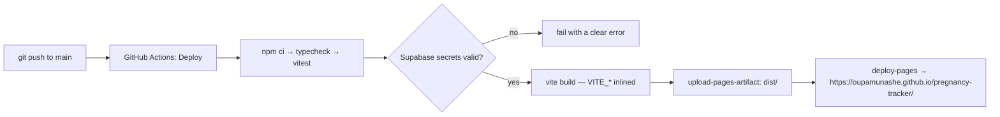
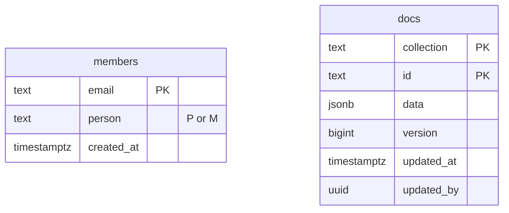
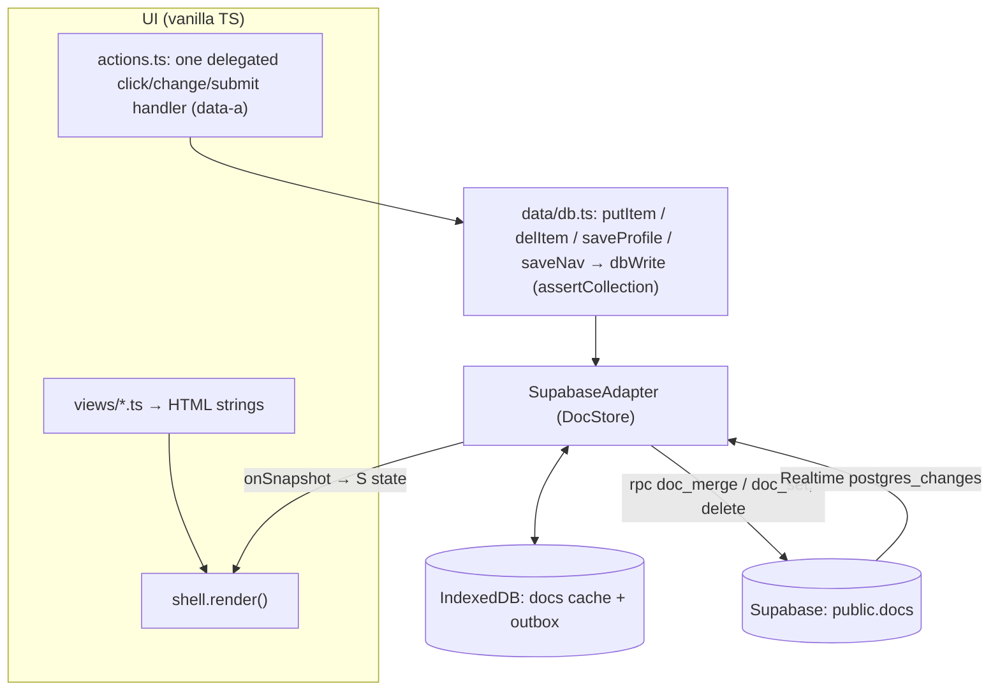
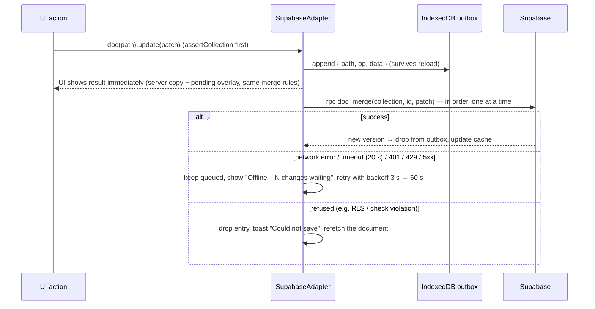

# Preggy — System Architecture & Specification

> **Preggy** — private two-person pregnancy tracker (installable PWA). Last updated 2026-10-18.
> This document describes the code **as it is**: where something is provided by another system (the shared Supabase backend) or is optional / untested, it says so.

**Contents** — [1 Overview](#1-system-overview--tech-stack) · [2 Data model](#2-data-model--database-schema) · [3 Modules](#3-core-application-modules) · [4 State & data flow](#4-state-management--data-flow) · [5 Security & limitations](#5-security-model--known-limitations) · [6 Maintenance](#6-maintenance--extension-guide)


## At a glance

| | |
|---|---|
| **Web address** | https://oupamunashe.github.io/pregnancy-tracker/ (GitHub Pages project site, base path `/pregnancy-tracker/`) |
| **Repository** | `oupamunashe/pregnancy-tracker` on GitHub — default branch `main` (currently public) |
| **Installed app name** | **Preggy** (PWA manifest `name` and `short_name`; page title "Preggy") |
| **Framework** | Vite 6 + **TypeScript** + one global CSS file. **Not React** — the UI is vanilla TypeScript (string-template views + one delegated event handler) |
| **Backend** | Supabase: PostgreSQL with Row Level Security, Auth, Realtime, Storage (private `files` bucket), optional Edge Function |
| **Deploy** | push to `main` → GitHub Actions (`Deploy`) → static build → GitHub Pages |
| **Status when written** | live site returns 200 and serves the "Preggy" manifest; the three most recent `Deploy` runs succeeded; 9 test files / 67 tests pass; typecheck clean |

---

## 1. System overview & tech stack

Preggy is a **client-only single-page app**: static files on GitHub Pages talk directly to a **Supabase** project. There is no application server of its own. Two people (Piepie = `P`, Munny = `M`) sign in with email + password; everything they enter is stored in the same shared documents and synced live between their phones, with an offline outbox.

| Layer | Technology | Notes |
|---|---|---|
| Language / build | **TypeScript 5.9**, **Vite 6** | strict mode; `noImplicitAny` off (DOM-heavy code) |
| UI | **Vanilla TypeScript** — string-template views, one delegated event handler | **No React / no framework.** Views are functions returning HTML; interactions use `data-a="<action>"` attributes handled in `src/ui/actions.ts` |
| Styling | **One global stylesheet** `src/styles/app.css` | CSS custom properties for the theme; no CSS Modules, no Tailwind |
| Backend | **Supabase** (PostgreSQL + Auth + Realtime + Storage + optional Edge Function) | `@supabase/supabase-js` ^2.109 |
| Local persistence | **IndexedDB** via `idb` ^8 | cached documents + the write **outbox**; `localStorage` for tiny UI prefs |
| PWA | `vite-plugin-pwa` ^1.3 (Workbox `generateSW`) | installable, offline app shell, runtime-cached fonts |
| Tests | **Vitest** ^3.2, `fake-indexeddb`, a hand-written fake Supabase | 9 files, 67 tests |
| Hosting | **GitHub Pages**, built by **GitHub Actions** | project site under base path `/pregnancy-tracker/` |

Runtime dependencies are only `@supabase/supabase-js` and `idb`. Everything else is dev-time.

### 1.1 Repository layout

```
index.html                  entry (title, icon links, PWA meta); loads /src/main.ts
vite.config.ts              base path, PWA manifest + Workbox config
src/
  main.ts                   start-up: demo mode OR sign-in → membership → adapter → shell → subscribe
  auth/                     auth.ts (Supabase client, sign-in helpers, members check) · session.ts
  core/                     pure logic + shared state (no DOM)
    gestation.ts            EDD / week / trimester maths      calc.ts   kicks, 5-1-1, budget, names, care, events, diapers
    nav.ts                  navigation engine                 content.ts seeds, week sizes, task templates
    state.ts                the app state object `S`          types.ts  document item types, LIST_KEYS
    diaper.ts · ctx.ts · format.ts · hooks.ts
  data/                     the storage layer
    adapter.ts              DocStore interface, collection constants, assertCollection / ownsPath
    supabase.ts             SupabaseAdapter (writes, outbox, Realtime, reconciliation)
    offline.ts              IndexedDB: cached docs + outbox        files.ts  private-bucket uploads
    db.ts                   document paths, write helpers, seeds, subscriptions
    merge.ts                client copy of the server's deep-merge   memory.ts  in-memory store (tests/demo)
  ui/                       shell.ts (nav + render) · actions.ts · sheet.ts · signin.ts · navpanel.ts
                            linkimage.ts · image.ts · parts.ts · views/*.ts (one file per module)
  styles/app.css            all styles + @font-face rules
public/                     fonts/ (14 Century Gothic TTFs) · pm-mark.jpg · PWA icons
supabase/
  migrations/0003_…sql      adds this app's collections to the shared docs table
  functions/link-preview/   optional Edge Function (index.ts + parse.ts)
tests/unit/ · tests/helpers/fake-supabase.ts
scripts/check-supabase.mjs  `npm run check` — verifies env, RLS and both logins
.github/workflows/deploy.yml
```

### 1.2 Configuration

| Variable | Where | Meaning |
|---|---|---|
| `VITE_SUPABASE_URL` | `.env.local` (dev) / GitHub secret (CI) | exactly `https://<project-ref>.supabase.co` — no trailing slash, spaces, quotes or `/rest/v1` |
| `VITE_SUPABASE_ANON_KEY` | same | the **anon public** key. Never the `service_role` key |

Vite **inlines `VITE_*` at build time**, so changing them requires a rebuild/redeploy. The client (`auth.ts`) cleans pasted values (trim, quotes, trailing slash/suffix) and refuses a malformed URL with a readable error instead of a bare "Failed to fetch". Without the variables the sign-in screen shows "Not set up yet". `.env.local` is git-ignored; only `.env.example` is committed.

### 1.3 Deployment pipeline



`.github/workflows/deploy.yml` (Node 20) runs on every push to `main` and on manual dispatch. The **"Check the Supabase settings"** step fails the build if either secret is missing, if the URL is malformed, if the key is the `service_role` key, or if the URL and the key's embedded project ref disagree — so a site can never ship without its login gate. Required repository secrets: `VITE_SUPABASE_URL`, `VITE_SUPABASE_ANON_KEY`. Pages source must be set to **GitHub Actions** (repo Settings → Pages). GitHub Pages from a *private* repo needs a paid plan.

The PWA service worker precaches the app shell (JS/CSS/HTML/PNG/SVG); Supabase traffic is never cached by the service worker.

---

## 2. Data model & database schema

### 2.1 One shared backend

Preggy shares a Supabase project (and its schema) with a sibling app, the **Pa-Nashe tracker**. The core objects below — `members`, `docs`, `doc_set`, `doc_merge`, `jsonb_deep_merge`, `is_member()`, the Realtime publication and the `files` bucket — are created by **that project's `0001_init.sql`, which is not in this repository**. Preggy's only migration is [`0003_pregnancy_collections.sql`](supabase/migrations/0003_pregnancy_collections.sql). The behaviour documented here for the shared objects was read from that migration.


*There is no foreign key between them: every `docs` policy calls `is_member()`, which looks the caller's email up in `members`.*

### 2.2 `public.members` — the allow-list

| Column | Type | Notes |
|---|---|---|
| `email` | text, PK | sign-in email (compared case-insensitively) |
| `person` | text, CHECK in (`'P'`,`'M'`) | **P** = Piepie, **M** = Munny |
| `created_at` | timestamptz | |

RLS is on; the only policy (`members_read`) lets an authenticated member `select`. **`public.is_member()`** (`SECURITY DEFINER`, `stable`) returns true when the caller's JWT email is in `members`; it is the gate used by every policy. In the app (`auth.ts → membership()`), after sign-in the client reads `members`, finds its row, and uses `person` as `S.me` (overridable per device via Settings → *This device*). The result is cached in `localStorage` (`pt_member:<userId>`) so the app can open offline. A signed-in user who is **not** a member sees "This tracker is private"; there is no sign-up UI and sign-ups must be disabled in the Supabase dashboard.

### 2.3 `public.docs` — the document store

| Column | Type | Notes |
|---|---|---|
| `collection` | text | CHECK-constrained (see 2.4) |
| `id` | text, 1–200 chars | document id |
| `data` | jsonb | the document |
| `version` | bigint, default 1 | incremented by `doc_set` / `doc_merge`; used by the client to ignore stale copies |
| `updated_at`, `updated_by` | timestamptz, uuid | |

Primary key `(collection, id)`. RLS: separate `select / insert / update / delete` policies, each `using / with check (public.is_member())`; `authenticated` has table grants, `anon` has none.

### 2.4 Collection mappings

The CHECK constraint on `docs.collection` allows exactly:

`config`, `months`, `milestones`, `logs`, `tools`, `prep`, `preg_lists`, `gestations`

| Collection | Used by Preggy? | Contents |
|---|---|---|
| **`gestations`** | **yes — owned** | one document per pregnancy profile. id = profile id → `{ nickname, lmp, notes, icon, status, createdAt }` |
| **`preg_lists`** | **yes — owned** | all module data. id = `<profileId>~<listKey>` → `{ items: { <itemId>: item \| null } }` |
| **`config`** | **yes — only `preg-*` ids** | `config/preg-nav` → `{ P: { tabs: […] }, M: { tabs: […] } }` (navigation prefs). Other `config` ids (`main`, `catalog`, `accounts`…) belong to Pa-Nashe and are never touched |
| `months`, `milestones`, `logs`, `tools` | no | other apps' collections; ignored by Preggy |
| `prep` | no (name clash!) | a *collection* name in the allow-list. Preggy's **prep checklists** are a **list** (`<profileId>~prep`) inside `preg_lists`, not this collection |

`listKey` is one of `LIST_KEYS` (`src/core/types.ts`):

| listKey | Module | Item shape (key fields) |
|---|---|---|
| `weekly` | Weekly milestones | `{ done, by, at }` keyed by task key (e.g. `w20-…`) |
| `symptoms` | Symptom logger | `{ d, kind, sev 1–3, note, by, at }` |
| `kicks` | Kick counter | `{ start, end\|null, goal, by, taps: { <tapId>: ms\|null } }` |
| `contractions` | Contraction timer | `{ start, end\|null, by }` |
| `prep` | Prep checklists | `{ text, group, done, by }` (groups: `bag-parent`, `bag-partner`, `bag-baby`, `admin`) |
| `budget` | Budget | `{ category, item, est, actual\|null, status, link }` |
| `names` | Baby names | `{ name, meaning, origin, note, votes: {P,M}, fav: {P,M}, by, at }` |
| `nursery` | Nursery planner | `{ text, todo, status, est, link, done }` |
| `vision` | Vision board | `{ image, fileId, source, title, notes, swatches: { <hex>: true\|null }, at }` |
| `photos` | Photo milestones | `{ kind bump\|scan, week, d, caption, fileId\|url, by, at }` |
| `daycares` | Daycare & caregivers | `{ kind, name, fee, hours, status, ratings: {P,M}, visits: { <id>: {d,note,by} }, … }` |
| `supplies` | Supplies | `{ group, text, need, have, est }` |
| `diapers` | Diaper log | entries `{ at, kind wet\|dirty\|both, by }` + reserved item **`_stock`** `{ stock, perPack, at, weight }` |
| `providers` | Care providers | `{ name, role, phone, email, address, emergency, at }` |
| `appointments` | Appointments | `{ title, type, providerId, date, time, status, vitals: {bp, weight}, notes, questions, by, at }` |
| `photographers` | Photography directory | `{ kind, name, contact, portfolio, quote, deposit, status, contract, signed, shootDate, shootTime, location, notes }` |
| `events` | Events planner | `{ kind, title, date, time, venue, budget, notes, guests{}, tasks{}, expenses{}, links{} }` |

**Why lists are maps, not arrays.** `doc_merge` merges objects key-by-key but *replaces* arrays. Storing `items` (and nested `guests`, `tasks`, `taps`, `swatches`…) as **maps keyed by id** means two phones adding or editing different entries at once both survive. `null` is a **tombstone** meaning "deleted". Values two people each own are stored **per person** (`votes: {P, M}`, `fav`, `ratings`, nav `P`/`M`) so each phone writes only its own key.

### 2.5 SQL functions

| Function | Behaviour |
|---|---|
| `jsonb_deep_merge(a, b)` | objects merge key-by-key **recursively**; arrays, scalars and `null` **replace**; a JSON `null` is stored (tombstone). Mirrored client-side by `src/data/merge.ts` for optimistic display |
| `doc_set(collection, id, data) → bigint` | full replace / create; bumps `version`; returns it. `SECURITY INVOKER` (RLS applies) |
| `doc_merge(collection, id, patch) → bigint` | **atomic** server-side deep merge (insert-or-merge in one statement); bumps `version`; returns it. `SECURITY INVOKER`. This is the write path for virtually every change |
| `is_member() → boolean` | see 2.2 |

Preggy never sends `doc_set` except through the generic adapter; every helper in `db.ts` uses `update` (= `doc_merge`) or `delete`.

### 2.6 Realtime

`public.docs` is in the `supabase_realtime` publication. Realtime evaluates RLS with the user's JWT, so only signed-in members receive change events. The client opens one channel (`preg-docs`) on `postgres_changes` for `public.docs` and filters events to its own documents (2.8).

### 2.7 Storage — the `files` bucket

A **private** bucket `files` (`public = false`), created by the shared migration. `storage.objects` policies for `select / insert / update / delete` all require `bucket_id = 'files' and public.is_member()`. Preggy uses it for **photo milestones** and **vision-board uploads**:

- object name `preg-<uuid>.<ext>`; the document stores only that **file id**;
- images are downscaled in the browser to **≤1000 px JPEG (q 0.78)** before upload (`ui/image.ts`);
- reads use **signed URLs** (1 h; cached client-side for 55 min) resolved after render (`hydrateFiles()` for ``);
- uploads need a connection and are **not** outbox-queued (offline shows a clear message; pasted image links still work offline).

(The same bucket serves Pa-Nashe's receipts; the `preg-` prefix keeps the two apps' objects distinguishable.)

### 2.8 Migration `0003_pregnancy_collections.sql`

Guards that `docs`, `doc_merge` and `is_member` exist (otherwise raises *"Run the Pa-Nashe 0001_init.sql first"*), then **reads whatever values the existing `collection` CHECK allows, keeps all of them, and adds `gestations` and `preg_lists`**. It is additive, idempotent (handles both `ARRAY[...]` and `'{...}'::text[]` constraint text), never drops an allowed value, and does nothing if both are already allowed. It was tested against an in-process Postgres with three different starting constraints. **No other migration is needed** for any Preggy feature.

### 2.9 Optional Edge Function — `link-preview`

`supabase/functions/link-preview` returns `{ image, title, site }` for a page URL (used for Pinterest pins). Browsers cannot read other sites' HTML (CORS) and Pinterest serves `og:image` only to server-side requests, so this runs in the project. Controls: caller must be signed in **and** `is_member()`; **https only**, no credentials, **SSRF guard** (loopback, RFC1918, CGNAT, link-local/metadata, `.local`/`.internal`, IPv6 ULA/loopback), re-checked on each of ≤4 manual redirects plus a best-effort DNS check; 8 s timeout, 600 kB read cap, HTML only; CORS limited to the Pages origin and `localhost:5173`. Deploy: `supabase functions deploy link-preview`. **Not deployed or run by the test suite** (Deno isn't part of the toolchain); its pure parsing/SSRF logic in `parse.ts` is unit-tested.

---

## 3. Core application modules

Views live in `src/ui/views/`; shared logic in `src/core/`. Thirteen modules plus Home and Settings.

| id | Module | id | Module |
|---|---|---|---|
| `weeks` | Weekly milestones (baby size, to-dos) | `nursery` | Nursery planner + vision board |
| `care` | Medical care & appointments | `photos` | Photo milestones |
| `events` | Events & photography | `daycare` | Daycare & caregivers |
| `symptoms` | Symptom logger | `supplies` | Supplies & diaper log / size calculator |
| `kicks` | Kick counter | `budget` | Budget |
| `contractions` | Contraction timer (5-1-1 guide) | `names` | Baby names (votes, hearts, matches) |
| `prep` | Prep checklists | | **Home** (progress wheel, countdown, next appointment) · **Settings** |

All dates derive from the **LMP**: `EDD = LMP + 280 days`; a week's date = `LMP + 7n`; trimester: weeks 0–13 / 14–27 / 28+ (`core/gestation.ts`, local-date maths, DST-safe).

### 3.1 Medical Care & Appointments (`care`)
*Files:* `ui/views/care.ts`, `core/calc.ts` (`splitAppts`, `carriedQuestions`, `weekAtDate`, `daysUntil`). *Lists:* `providers`, `appointments`.
- **Providers** — role (OB/GYN, GP, Midwife, Doula, Hospital, Other), phone/email/address (rendered as `tel:`, `mailto:` and map links) and a highlighted **emergency note**.
- **Appointments** — type (Prenatal visit, Ultrasound, Blood test, Other), linked provider, date/time, status **Scheduled / Completed**, vitals (BP, weight), doctor's notes, **questions for the next visit**. The pregnancy week at the appointment date is shown automatically.
- **Carry-over:** the questions noted on the most recent *completed* visit are shown on the next *scheduled* one. Marking a visit completed opens its details so vitals/notes can be entered.
- Upcoming sorted soonest-first (date + time), completed newest-first. **Home** shows the next appointment card.

### 3.2 Events & Photography (`events`)
*Files:* `ui/views/events.ts`. *Lists:* `events`, `photographers`.
- **Events planner** — *baby shower* or *gender reveal*, each seeded with a starter checklist. Per event: title/date/time/venue/budget; **task checklist**; **guest list** with contact, **RSVP** (Pending/Yes/No/Maybe) and plus-ones with a live tally (*headcount = Yes guests + their plus-ones*); **expenses** vs budget (left/over); **registry & links** (https-validated); notes.
- Guests, tasks, expenses and links are **nested maps inside the event document**, edited with dotted-path merges (e.g. `guests.<id>.rsvp`) so concurrent edits don't clobber each other.
- **Photography directory** — maternity / birth / newborn shoots with status (Enquiry → Quoted → Booked → Completed / Declined), quote, deposit paid, contact, portfolio link, **contract** (link or key terms) with a *signed* flag, shoot date/time/location, notes. Summary: booked count and booked total.
- *Separate from* the **Photo milestones** module (`photos`), which stores bump/scan pictures.

### 3.3 Nursery Vision Board (`nursery`)
*Files:* `ui/views/nursery.ts`, `ui/linkimage.ts`, `ui/actions.ts`. *Lists:* `nursery` (planner), `vision` (cards).
- **Planner** — items with status (To buy → Ordered → Delivered → Assembled → Set up), to-do, cost, link; ticking "done" sets *Set up*.
- **Vision cards** — picture + notes + colour swatches. Swatches are a map `{ "<hex>": true|null }`; the toolbar offers **8 presets** (4 brand colours + 4 neutrals) and a rainbow **custom colour picker** (`<input type="color">`, committed on `change`). A picked colour equal to a preset (case-insensitive) switches that preset on instead of duplicating; custom swatches appear as extra circles and in the card's colour strip, and toggle off on click.
- **Image resolution** (`resolveLink`), in order: ① direct image link (extension or image CDN such as `i.pinimg.com`) → used as-is; ② any other URL that **loads as an image** (browser probe, 6 s) → used; ③ a page (e.g. a Pinterest pin) → ask the optional `link-preview` function for its image/title (Pinterest thumbnails upgraded to the `736x` copy), keeping the pin as `source`; ④ otherwise a **link card** (📌/🔗, title/host, *Open link ↗*, and *Fetch picture* when the function exists). A dead image link is swapped for the same card by a capture-phase `error` listener — the frame is never empty. Uploaded files go to the `files` bucket (2.7).

### 3.4 Navigation engine (`config/preg-nav`)
*Files:* `core/nav.ts`, `ui/navpanel.ts`, `ui/shell.ts`, `ui/views/settings.ts`. *Document:* `config/preg-nav`.
- **10 primary slots** = **Home** + up to **7 chosen modules** + **More** + **Settings**. Home, More and Settings are fixed. `MAX_SLOTS = 10`, `MAX_TABS = 7`; default 7: `weeks, care, kicks, contractions, symptoms, prep, budget`.
- Modules not chosen live in the **More** drawer: a tile page on mobile; on desktop **one expandable "More" item** in the sidebar (collapsed by default, auto-open while viewing a hidden module). The mobile tab bar scrolls horizontally when all 10 slots are used.
- **Per person, persisted:** each partner's layout is stored under their own key — `config/preg-nav → { P: { tabs }, M: { tabs } }` — so each keeps a personal menu on every device. No saved layout → the defaults.
- **Editor:** *Settings → Navigation & Menu Layout* — reorder (▲▼), remove, add; draft edits show an *Unsaved changes* flag and apply only on **Save menu** (Discard / Reset available). The cap is enforced in the UI and in `addTab`; `sanitizeTabs` drops unknown ids, duplicates and anything past 7 and falls back to defaults if empty.

### 3.5 Branding & assets
- **Fonts** — body, headings, buttons, form controls, tables, sheets and toasts use `font-family: 'Century Gothic', sans-serif`. **14 self-hosted TrueType files** (`public/fonts/CenturyGothicPaneuropean*.ttf`: Thin 100, Light 300, Regular 400, SemiBold 600, Bold 700, ExtraBold 800, Black 900, each with italic) are declared with `@font-face` (`font-display: swap`) and served under the base path. Each face downloads only when used; the service worker **runtime-caches** them (`CacheFirst`, 1 year, ≤20 entries) rather than precaching all ~4.5 MB. *History:* an earlier iteration used self-hosted Questrial as a stand-in; it was removed when the real files were added. *Licensing:* Century Gothic is a commercial font — confirm web-embedding rights before keeping the files in a public repo.
- **Logo** — the floral **"PM" monogram**: `public/pm-mark.jpg` (512×512 sRGB, 53 kB) is the favicon, apple-touch-icon and the in-app brand mark (`.logo`). It is an optimised copy of a 5084 px CMYK master (4.9 MB, kept out of the repo). PNGs generated from it: `icon-192.png`, `icon-512.png`, `icon-maskable-512.png` (80 % artwork on white so OS crops don't clip it), `apple-touch-icon.png`.
- **PWA manifest** (generated from `vite.config.ts`): name/short_name **Preggy**, `lang en-ZA`, `display: standalone`, portrait, `theme_color #00A693`, `background_color #eeeae3`, `start_url`/`scope` `/pregnancy-tracker/`, three icons (192, 512, maskable 512). Service worker: `registerType: autoUpdate`, `skipWaiting` + `clientsClaim`, navigate-fallback to `index.html`.
- **Theme tokens** (`:root` in `app.css`): `--primary #00A693` (Persian Green), `--bg #D7CFC2` (Warm Oatmeal), `--accent #C5A57D` (Honey Oak), `--highlight #B5996D` (Brushed Brass).

---

## 4. State management & data flow

### 4.1 Layers



### 4.2 Local state
A single mutable object **`S`** (`core/state.ts`) holds: `db` (the DocStore), `assets` (file store), `user`, `profiles` (from `gestations`), `lists` (from `preg_lists`), `cfg` (own `config` docs), `loaded` flags, `me` (P/M), and `ui` (current view, selected tabs, drafts). Derived values come from `ctx()` (LMP → EDD, gestational age, progress, countdown). Persisted device prefs: `localStorage` keys `pt_active` (active profile), `pt_me` (who is using this phone), `pt_member:<userId>` (cached membership); the Supabase session is stored by supabase-js.

**Rendering:** `scheduleRender()` coalesces updates with `requestAnimationFrame` plus an 80 ms timer fallback (background tabs throttle rAF) and **defers while an input/textarea has focus** so Realtime updates never steal typing. Live clocks (`data-since`) tick every second without re-rendering. **Demo mode** (`npm run dev:demo`, `?today=YYYY-MM-DD&me=P|M`) swaps in the in-memory adapter with sample data and no login.

### 4.3 Write path (offline-first)



Per-document writes are serialised (`dbWrite` queue) and the outbox is replayed **in order** on reconnect. The pending overlay uses the same deep-merge as the database, so what you see equals what the server will hold.

### 4.4 Read & real-time path
1. **Start:** documents cached in IndexedDB are loaded first, so the app opens instantly even offline.
2. **Fetch:** `fetchAll()` queries `docs` for the app's own collections (and only `config` ids starting `preg-`) on start, on Realtime `SUBSCRIBED`, on the browser `online` event and when the tab becomes visible.
3. **Live:** one Realtime channel; each change is applied if its **version ≥ the cached version** (an older copy never replaces a newer one). A trimmed payload triggers a single-document refetch. Deleted documents are removed. Recently acknowledged writes are protected from a stale refetch.
4. **Sign-out** stops the adapter, destroys the user's IndexedDB, clears local prefs and reloads.

### 4.5 Isolation & safety rules (cross-app collisions)
The shared table also holds Pa-Nashe's documents, so reads and writes are fenced at several levels:
- **Write allow-list:** `ALLOWED_COLLECTIONS` mirrors the database CHECK; `assertCollection(path)` runs in `dbWrite` **and** in the adapter before anything is queued, so a typo fails instantly with a clear message instead of a database error.
- **Ownership (`ownsPath`):** the app only reads/caches/applies `gestations`, `preg_lists`, and `config/preg-*`.
- **Query filters:** `.in('collection', ['gestations','preg_lists'])` plus a separate `.eq('collection','config').like('id','preg-%')`.
- **Realtime filter:** events for other collections, or `config` ids without the `preg-` prefix, are ignored.
- **Per-person keys** (`P`/`M`) for anything the two partners each own.
- All of the above are covered by tests (`collections.test.ts`, `supabase-adapter.test.ts`).

The reverse is not under Preggy's control: Pa-Nashe's own client fetches *all* `docs` rows, so it will cache Preggy's documents too (harmless — same two members — but adds a little data to its cache).

---

## 5. Security model & known limitations

**What protects the data**
1. **Row Level Security** on `docs`, `members`, `storage.objects`: every operation requires `is_member()`. `anon` has no table grants.
2. **Closed membership:** accounts are created in the Supabase dashboard; public sign-ups must be **off**. The app has no sign-up path.
3. The anon key in the bundle is public by design; without a valid member session it can read nothing. The `service_role` key must never be used in the app (the CI check and `npm run check` reject it).
4. The client gate (login screen) is a UX lock; **RLS is the real boundary**. Signing out wipes the device's local copy.

**Known limitations / operational notes**
- **Merge semantics:** within one document, scalars and arrays are last-writer-wins; per-item/per-person maps avoid this for list data. Very large logs (e.g. the diaper log) grow a single document.
- **Photo uploads are online-only**; everything else queues offline.
- **Service worker / install flow** has not been verified in an automated browser (the preview browser can't register service workers); verify on a real phone.
- **`link-preview` is optional and undeployed by default**; without it, pins show a link card. It is not covered by integration tests.
- **Public repository:** source, fonts and git history are public. The real partner email addresses appear in *earlier commits* (an old allow-list file); consider recreating the repo if that matters. GitHub Pages for a private repo needs a paid plan.
- **Fonts:** see the licensing note in 3.5.
- Renaming the app does not rename the Pages URL (`/pregnancy-tracker/`); an installed home-screen icon keeps its old name until re-added.

---

## 6. Maintenance & extension guide

### 6.1 Everyday commands

| Task | Command |
|---|---|
| Install | `npm install` |
| Dev server (reachable from phones on the Wi-Fi) | `npm run dev` → `http://localhost:5173/pregnancy-tracker/` |
| Demo, no login, sample data | `npm run dev:demo` (`?today=2026-12-20&me=P`) |
| Typecheck | `npm run typecheck` |
| Tests (9 files / 67 tests) | `npm test` |
| Production build → `dist/` | `npm run build` (needs `.env.local` for a working gate) |
| Preview the real build | `npm run preview` |
| Verify env, RLS and both logins | `npm run check` (prompts for passwords; nothing is stored) |

### 6.2 Manual GitHub Pages redeploy
- GitHub → **Actions → Deploy → Run workflow** (branch `main`), **or** push any commit: `git commit --allow-empty -m "Redeploy" && git push origin main`.
- If the build fails at the Supabase step, fix the repo secrets (`VITE_SUPABASE_URL` must be exactly `https://<ref>.supabase.co`; `VITE_SUPABASE_ANON_KEY` the anon key). Secrets are baked in at build time — **re-run the workflow after changing them**.
- Roll back: revert the commit and push (the history also has the earlier Next.js version at tag `nextjs-final`, local only unless pushed).

### 6.3 Adding a new feature that stores data (a new **list**) — *no migration needed*
1. **Type:** add the item interface and the key to `ListKey` **and** `LIST_KEYS` in `core/types.ts` (the key becomes `preg_lists/<profileId>~<key>`; `deleteProfile` iterates `LIST_KEYS`, so it is cleaned up automatically).
2. **Logic:** put pure calculations in `core/calc.ts` and seeds/constants in `core/content.ts`; write unit tests.
3. **View:** add `ui/views/<module>.ts` exporting `viewX(): string` that reads `items<T>(ctx().id, '<key>')`. Use the helpers in `ui/parts.ts` (`editInp`, `editSel`, …); use `data-a="edit"` + `data-list/data-id/data-f` for inline fields (dotted `data-f` = nested merge).
4. **Actions:** add `case`s in `ui/actions.ts` that call `putItem / delItem`. Use **maps keyed by id** for anything with multiple entries, **per-person keys** for anything each partner owns, and `null` to delete.
5. **Wire it up:** register the view in `VIEWS` (`ui/shell.ts`); add an entry to `MODULES` in `core/nav.ts` (id, icon, label, short) so it appears in the menu/More; add demo data in `main.ts` if useful.
6. **Verify:** `npm run typecheck && npm test`. `tests/unit/collections.test.ts` automatically exercises every `LIST_KEY` and fails if a write would leave the allowed collections.

### 6.4 Adding a new **collection** (rare — new `docs.collection` value)
1. Add it to `ALLOWED_COLLECTIONS` (and, if Preggy owns it, to `Collection` / `COLLECTIONS`) in `data/adapter.ts`; extend `ownsPath` if it needs id-prefix isolation.
2. Update `0003_pregnancy_collections.sql` (or add `0004_…sql`) so the CHECK constraint accepts it — keep it **additive** (read existing values, union, re-add).
3. Subscribe to it in `data/db.ts → subscribe()` and, if it is shared with other apps, filter queries in `SupabaseAdapter.fetchAll()` and `onChange()`.
4. Update `tests/unit/collections.test.ts` (expected collection set) and add adapter tests; run the SQL against a scratch Postgres before the real project.

### 6.5 Adding / changing a navigation module
Only `MODULES` (and `DEFAULT_TABS`, if it should be in the default bar) in `core/nav.ts` plus a `VIEWS` entry. Saved layouts are sanitised on read, so adding or removing a module never breaks anyone's stored menu.

### 6.6 Changing icons, fonts or the app name
Replace files in `public/`; update `index.html` (title, icon links), the `manifest` block in `vite.config.ts`, and `@font-face` rules in `app.css`. Fonts under `public/fonts/` are served as-is; add new weights as new `@font-face` rules.

### 6.7 Backups & restore
A snapshot of the whole project (excluding `node_modules/`, `.git/`, `dist/`, `.vite/`, build leftovers and **secrets**: `.env*`, `*.local.sql`) is `pregnancy-tracker-backup-2026.zip` in the repo root (git-ignored locally; an earlier identical-content copy named `preggy-tracker-backup-2026.zip` may also exist). To restore: unzip, `npm install`, recreate `.env.local` from `.env.example`, `npm test`. **Application data lives in Supabase**, not in this repo — back it up from the Supabase dashboard (e.g. an export of `public.docs`).
